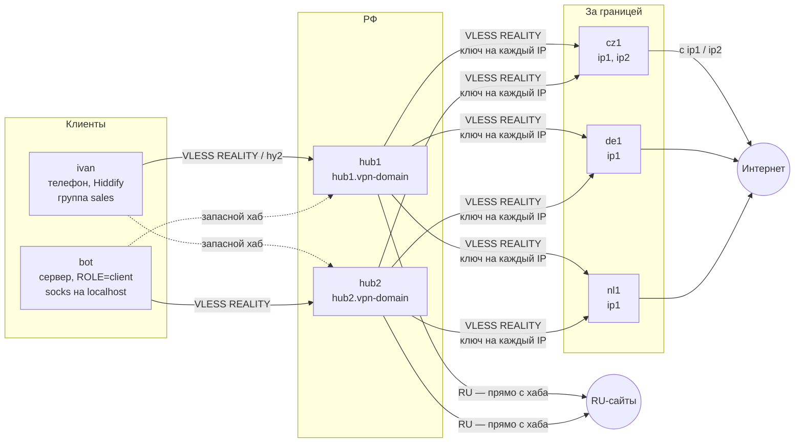
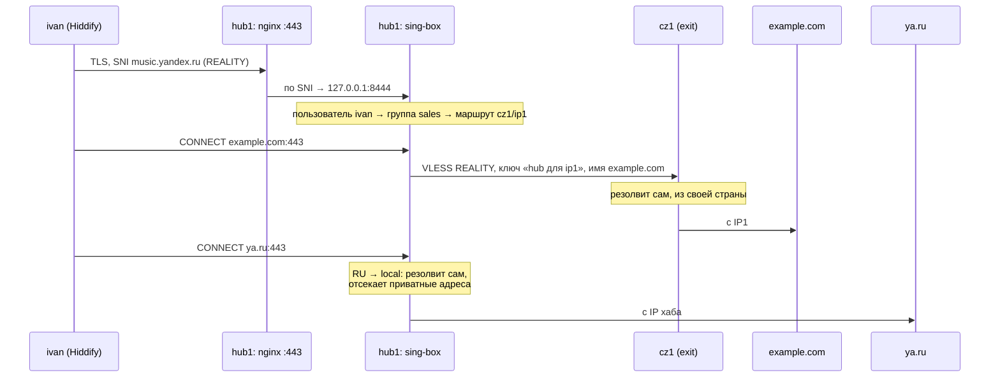
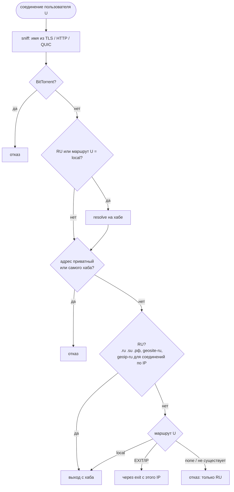
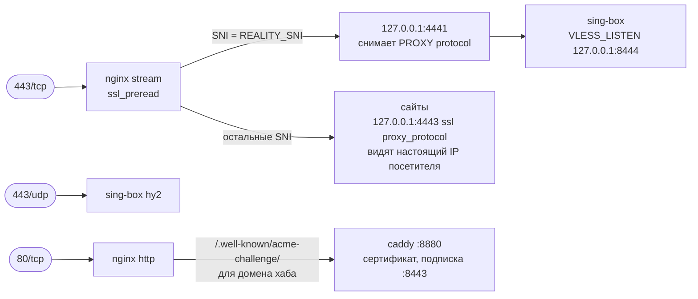
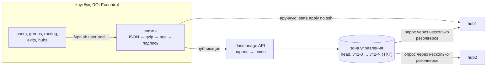
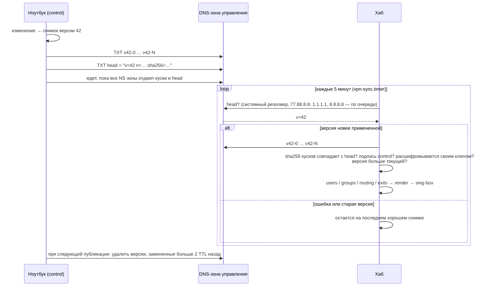
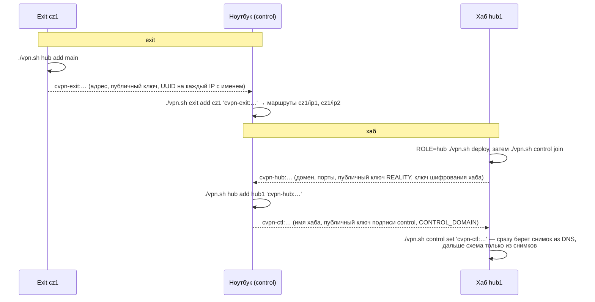

# Архитектура

Что строится в итоге: каскад на sing-box. Клиенты подключаются к хабам, хабы
выпускают трафик через exit'ы (по маршруту пользователя) или сами (RU), а
схемой управляет ноутбук через DNS. Здесь описана целевая картина; что уже
сделано — в таблице ниже, этапы — в [TODO.md](TODO.md). Связь хаб ↔ хаб
(hub2hub) рассматривается отдельно и сюда не входит.

| Часть | Статус |
|---|---|
| Хаб: VLESS REALITY + Hysteria 2, подписки, маршруты, группы, RU → `local` | сделано (этапы 1, 3) |
| Exit: выход с нескольких IP, ключ на каждый IP | сделано (этап 2) |
| Хаб за nginx на 443 (маршрутизация по SNI) | сделано (`VLESS_LISTEN`) |
| Control: схема на ноутбуке, подписанный снимок, `state apply` | сделано (этап 4) |
| Доставка снимка через DNS TXT | сделано (этап 5) |
| Несколько хабов в подписке, `ROLE=client` | этап 6 |

## Роли

Один `vpn.sh`, роль записана в `.env` (`ROLE=...`); `./vpn.sh help` показывает
команды своей роли.

| Роль | Где | Что делает |
|---|---|---|
| `hub` | сервер в РФ | принимает сотрудников (VLESS REALITY, hy2), отдает подписки, решает, куда выпустить трафик |
| `exit` | сервер за границей | принимает только хабы, выпускает трафик с нужного IP |
| `client` | сервер, которому нужен выход | sing-box на localhost (socks/http), конфиг — из подписки хаба |
| `control` | ноутбук | вся схема: пользователи, группы, маршруты, exit'ы, хабы; публикует снимок |

## Пример: 2 клиента, 2 хаба, 3 exit'а

- **ivan** — сотрудник, телефон с Hiddify, группа `sales` → маршрут `cz1/ip1`;
- **bot** — сервер с `ROLE=client`, свой маршрут `de1/ip1`;
- **hub1**, **hub2** — хабы в РФ, у каждого свой домен в VPN-домене;
- **cz1** (два IP: `ip1`, `ip2`), **de1**, **nl1** — exit'ы, всего 4 маршрута.



Таблица маршрутов одна на все хабы (она приходит в снимке), поэтому человек
выходит с одного и того же IP, через какой бы хаб ни подключился:

| Пользователь | Группа | Маршрут | Откуда | Не-RU выходит с | RU выходит с |
|---|---|---|---|---|---|
| ivan | sales | `cz1/ip1` | группа | IP1 cz1 | хаба, к которому подключен |
| bot | — | `de1/ip1` | свой | IP de1 | хаба |
| новый пользователь | — | `none` | `ROUTE_DEFAULT` | никуда | хаба |

Маршрут `cz1/ip2` и exit `nl1` в примере никому не назначены — они просто
готовы к использованию.

## Путь трафика



Хаб резолвит только то, что выпускает сам. На exit уходит имя: после
`resolve` sing-box отправил бы дальше IP, выбранный DNS из РФ (и, возможно,
IPv6, который exit не пропускает).

## Решение на хабе

Правила идут по порядку, первое совпадение решает:



Маршрут пользователя: свой → маршрут группы → `ROUTE_DEFAULT`. Маршрута
нет (exit удален, IP переименован) — трафик никуда не уходит, тихой замены
другим IP нет; `check` об этом сообщает.

## Порт 443 на хабе

Хаб может делить 443 с сайтами: nginx `stream` разбирает SNI, не расшифровывая.



Чужой, пришедший с SNI `REALITY_SNI` без ключа, получает настоящий сайт
`REALITY_SNI` (REALITY пересылает рукопожатие ему), с любым другим SNI —
обычный сайт сервера.

## Управление

Схема живет на ноутбуке (`ROLE=control`). Каждое изменение собирается в
снимок, который публикуется в отдельной DNS-зоне управления; хабы сами
забирают его. Заблокировать «сервер управления» нельзя — его нет, а DNS
доступен почти всегда.



Публикация и применение:



### Что в снимке

| Данные | Зачем хабу |
|---|---|
| пользователи: имя, UUID VLESS, логин и пароль hy2, токен подписки, сроки старых ключей | пускать и раздавать подписки |
| группы, маршруты пользователей, `ROUTE_DEFAULT` | куда выпускать |
| exit'ы: адрес, порт, SNI, публичный ключ, short id, UUID на каждый IP с именем | подключаться к exit'ам |
| хабы: имя, домен, порты, публичный ключ REALITY | подписка со всеми хабами |
| версия, время | не принять старый снимок |

Не входит: приватные ключи хабов (генерируются на самом хабе), ключ подписи и
пароль DNS (только на ноутбуке), сертификаты (у каждого хаба свои), списки RU
(хабы качают сами), A-записи узлов (обычный DNS VPN-домена).

### Записи в зоне управления

```
head.<зона>    TXT  "cvpn1 v=42 n=3 sha256=…"   указатель на текущую версию
v42-0.<зона>   TXT  "…"                          куски снимка по 1000 символов
v42-1.<зона>   TXT  "…"
v42-2.<зона>   TXT  "…"
```

Сначала публикуются куски; `head` переключается, только когда все NS зоны
отдают их, поэтому резолвер не увидит `head` без кусков. Куски версии удаляются
при следующей публикации, если ее сменили больше 2 TTL назад (столько живет
закэшированный старый `head`), а версии выше текущей — сразу: control таких не
пишет. Кусок в 1000 символов — ответ меньше 1232 байт, идет по UDP без TCP.
`<зона>` — `CONTROL_DOMAIN`: отдельный домен или поддомен (`DNS_ZONE` — зона в
dnsmanage, где он лежит). Подпись покрывает версию внутри снимка, поэтому подсунуть
через `head` старый снимок нельзя. Объем — около 170 байт на пользователя:
30 человек — 2–3 записи, 100 — около 10. Снаружи видно, что записи есть, их
число, размер и время смены, но не содержимое.

## Подключение узлов

Узлы связываются строками-токенами, которые копируются из вывода одной команды
в другую.



Все хабы пользуются одним набором ключей каждого exit'а: токен вводится один
раз в control и расходится по хабам в снимке, а exit о новых хабах не знает.

## Ключи: кто что знает

| Секрет | Где | Если утечет |
|---|---|---|
| ключ подписи control | только ноутбук | можно подменить схему: новый ключ, `control set` на хабах |
| пароль / токен dnsmanage | только ноутбук | можно испортить записи; хабы не примут неподписанное и останутся на старом снимке |
| ключ шифрования хаба (age) | этот хаб | можно читать снимки: удалить хаб из получателей |
| приватный ключ REALITY хаба | этот хаб | `init` с новым ключом; клиенты получат его с подпиской |
| ключи пользователей, ключи хабов к exit'ам | control, все хабы | `rotate --all`, перевыпуск токенов exit'ов |
| приватный ключ REALITY exit'а | этот exit | новый ключ и токен на exit'е, `exit add` в control |

Захват одного хаба равен утечке пользовательских ключей: хаб должен их знать,
чтобы пускать людей. Лечится ротацией и удалением хаба из получателей.

## Подписка и несколько хабов

Подписку отдает любой хаб (данные у всех одинаковые). В ней — все хабы:
клиент выбирает сам или автоматически (urltest). Если один хаб недоступен,
работают остальные; если недоступен хаб, с которого берется подписка,
перестает обновляться только она.

## Отказы

| Что случилось | Что видит пользователь | Что делать |
|---|---|---|
| exit недоступен | нет зарубежного интернета, RU работает; другой IP не подставляется | `check` на хабе падает → поднять exit или сменить маршрут в control |
| хаб недоступен или заблокирован | клиент переключается на другой хаб из подписки | заменить A-запись или поднять новый хаб |
| DNS-зона управления недоступна | ничего: хабы работают на последнем снимке | `state apply` по ssh, если изменение срочное |
| ноутбук потерян | ничего | восстановить каталог control из бэкапа; при утечке — новый ключ подписи |
| снимок испорчен или подменен | ничего: хаб его не применяет | — |
| списки RU не скачиваются | RU определяется только по `.ru .su .рф` и старым спискам | `./vpn.sh update rules`; списки качаются и через exit |

## Домены

| Домен | Для чего | Кто знает |
|---|---|---|
| VPN-домен (`cdn.specterite.ru`, `hub2.…`) | адреса хабов в ссылках, сертификаты hy2 и подписки | все клиенты |
| домен управления | только TXT со снимками | только хабы и ноутбук |
| exit'ам домен не нужен | — | — |

Домен управления отдельный: VPN-домен на виду у каждого клиента, и его
блокировка не должна отключать управление. Для надежности хабы могут читать
две зоны управления в разных доменных зонах — снимок подписан, годится тот,
что ответит.
